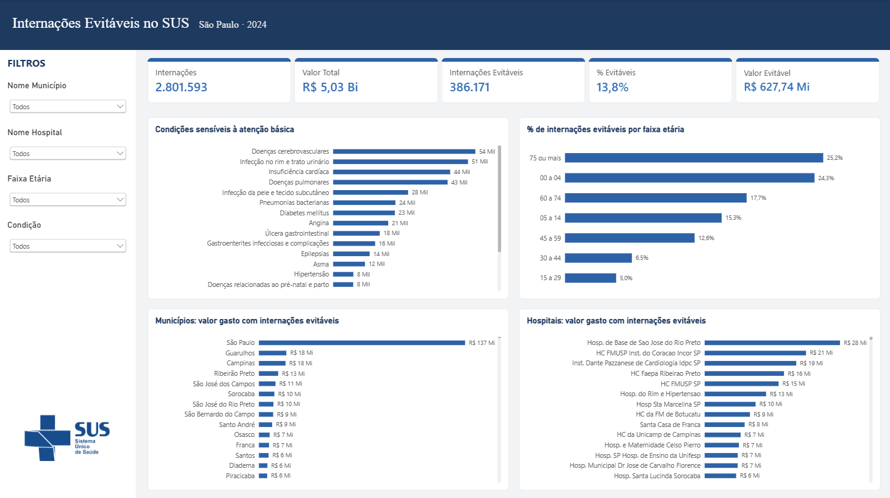
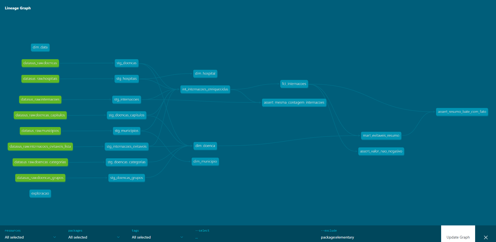

# Internações Evitáveis no SUS · São Paulo · 2024

Projeto de dados de ponta a ponta sobre **internações por condições sensíveis à atenção primária (ICSAP)** no estado de São Paulo, usando dados abertos do DATASUS (SIH/SUS).

> **Pergunta:** quantas internações do SUS em SP poderiam ter sido evitadas com uma atenção básica eficiente, quanto elas custaram e onde se concentram?



---

## Principais resultados

| Indicador | Valor |
|---|---|
| Internações (2024) | **2.801.593** |
| Valor pago | **R$ 5,03 bi** |
| Internações evitáveis (ICSAP) | **386.171** |
| % evitáveis | **13,8%** (≈ 1 em cada 7) |
| Valor gasto com evitáveis | **R$ 627,7 mi** |

- **AVC** e **infecção urinária** lideram as internações evitáveis, seguidas de insuficiência cardíaca e doenças pulmonares.
- Os extremos de idade concentram o problema: **75+ anos (25%)** e **0 a 4 anos (24%)** têm a maior proporção de internações evitáveis; 15 a 29 anos, apenas 5%.
- **São Paulo (capital)** responde por cerca de R$ 137 mi do gasto evitável; entre os hospitais, o **Hospital de Base de São José do Rio Preto** lidera (~R$ 28 mi).

> "Evitável" não significa que a internação era desnecessária: significa que, com acompanhamento adequado na atenção básica (controle de pressão, glicemia, vacinação, tratamento precoce), o quadro provavelmente não teria chegado ao ponto de exigir internação. Lista oficial: Portaria SAS/MS nº 221/2008.

---

## Arquitetura

```
DATASUS (SIH/SUS RD-SP)
        │  Python
        ▼
   Amazon S3  ──►  AWS Athena  ──►  dbt (staging → intermediate → marts)  ──►  Power BI
   (raw)           (SQL)            testes + Elementary                        (Import)
```

| Camada | Ferramenta | O que faz |
|---|---|---|
| Ingestão | Python | Baixa os arquivos do DATASUS e envia para o S3 |
| Armazenamento | Amazon S3 | Data lake (camada raw) |
| Processamento | AWS Athena | Motor SQL serverless (paga por dado lido) |
| Transformação | dbt Core + dbt-athena | Modelagem em camadas, testes e documentação |
| Qualidade | Elementary | Relatório de testes e lineage |
| Visualização | Power BI | Dashboard em formato `.pbip` (versionado no Git) |

### Star Schema

- **Fato:** `fct_internacoes` (uma linha por AIH, apenas tipo 1)
- **Dimensões:** `dim_municipio`, `dim_hospital`, `dim_doenca`, `dim_data`
- **Agregado:** `mart_evitaveis_resumo`



---

## Decisões técnicas

- **Só AIH tipo 1.** O tipo 5 (longa permanência) repete a mesma AIH a cada mês de cobrança; contá-la inflaria o número de internações.
- **CIDs de 3 caracteres.** Parte dos registros vem sem o dígito de detalhe (ex.: `I64` em vez de `I640`). A `dim_doenca` inclui as categorias de 3 caracteres para não perder esses registros.
- **`dim_data` ligada à `data_internacao`.** O `ano`/`mes` do SIH é a **competência** (mês de pagamento), não o mês da internação.
- **Nomes de hospitais abreviados** com Jinja/SQL no dbt (`nome_hospital_curto`), para leitura no dashboard.
- **Custo mínimo:** workgroup do Athena com limite de 1 GB por consulta, tabelas materializadas apenas nos marts e Power BI em modo Import (sem consultas a cada clique).

---

## Qualidade e validação

- **Testes dbt:** `unique`, `not_null`, `accepted_values`, `relationships` e testes singulares (ex.: a soma do resumo bate com a fato; valores não negativos).
- **Validação externa:** os totais de AIH aprovadas, internações e valor total foram conferidos com o **TabNet/DATASUS**, com **diferença zero**. Detalhes em [`analyses/validacao_tabnet.md`](datasus_icsap/analyses/validacao_tabnet.md).
- **Relatório Elementary:** [natmartines.github.io/datasus-icsap/elementary](https://natmartines.github.io/datasus-icsap/elementary/)
- **Documentação com IA:** usei o Claude para acelerar a documentação das tabelas e revisei cada descrição contra o dicionário do DATASUS. A skill usada está em [`.claude/skills/documentar-tabelas-dbt`](.claude/skills/documentar-tabelas-dbt/SKILL.md).

---

## Limitações

- CIDs registrados só com 3 caracteres são tratados como **não evitáveis**, então o número de evitáveis pode estar levemente subestimado.
- Cerca de **3,4%** das internações têm CNES que não consta no cadastro de hospitais (teste em `warn`).
- **121** internações usam CIDs novos (ex.: N18.2–N18.5, U09, U10) que não estão na tabela de doenças (teste em `warn`).
- Partos não foram excluídos do denominador.
- Escopo: estado de São Paulo, competências de 2024.

---

## Ingestão

A ingestão é feita por scripts Python em `ingestion/`, executados **nesta ordem**:

| # | Script | O que faz |
|---|---|---|
| 1 | `ingest_sih.py` | Baixa os arquivos `.dbc` do SIH/SUS (AIH Reduzida) do FTP público do DATASUS, converte para Parquet e envia para o S3 |
| 2 | `create_raw_table.py` | Cria a tabela `datasus_raw.internacoes` no Athena, com *partition projection* (ano/mês/UF) |
| 3 | `ingest_referencias.py` | Baixa as tabelas de referência (municípios do IBGE, CID-10, hospitais e leitos do OpenDataSUS, lista ICSAP) e cria as tabelas no Athena |
| 4 | `simplificar_tabelas.py` | Deixa as referências com uma linha por código, prontas para JOIN simples |

```bash
uv run python ingestion/ingest_sih.py --uf SP --ano 2024
uv run python ingestion/create_raw_table.py
uv run python ingestion/ingest_referencias.py
uv run python ingestion/simplificar_tabelas.py
```

**Organização no S3:**

```
s3://<bucket>/
├── landing/sih_rd/ano=AAAA/mes=MM/uf=UF/   # .dbc original do DATASUS
└── raw/
    ├── sih_rd/ano=AAAA/mes=MM/uf=UF/       # Parquet (todas as colunas como texto)
    └── ref_*/                              # tabelas de referência
```

- **Idempotente:** se o Parquet do mês já existe no S3, o mês é pulado (use `--force` para reprocessar).
- **Tudo como texto na raw:** a tipagem fica a cargo da camada de staging do dbt.
- **Partition projection:** o Athena encontra as partições pelo caminho no S3, sem crawler e sem `MSCK REPAIR`.

---

## Como rodar

**Pré-requisitos:** Python 3.11+, [uv](https://github.com/astral-sh/uv), conta AWS com S3 e Athena, Power BI Desktop e driver ODBC do Athena.

```bash
# 1. Ambiente
uv sync

# 2. dbt (dentro da pasta do projeto)
cd datasus_icsap
dbt deps
dbt build --exclude package:elementary

# 3. Relatório de qualidade
edr report
```

O `profiles.yml` (credenciais) **não** está no repositório. Use o perfil AWS configurado localmente.

**Dashboard:** abra `dashboard/datasus_icsap.pbip` no Power BI Desktop. A conexão usa um DSN ODBC chamado `datasus-athena`.

---

## Estrutura do repositório

```
datasus-icsap/
├── ingestion/          # scripts de ingestão (DATASUS → S3)
├── datasus_icsap/      # projeto dbt
│   ├── models/
│   │   ├── staging/
│   │   ├── intermediate/
│   │   └── marts/
│   ├── tests/
│   ├── macros/
│   └── analyses/
├── dashboard/          # Power BI (.pbip)
└── docs/               # imagens e relatório Elementary (GitHub Pages)
```

---

## Fonte dos dados

- **SIH/SUS:** Sistema de Informações Hospitalares, DATASUS / Ministério da Saúde
- **Lista ICSAP:** Portaria SAS/MS nº 221, de 17 de abril de 2008

Projeto pessoal de portfólio, feito com dados públicos. Não é um painel oficial do Ministério da Saúde.

---

**Natália Martines** · [LinkedIn](www.linkedin.com/in/nathaliamartines) · [GitHub](https://github.com/NatMartines)